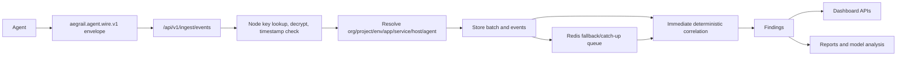

# Hub How It Works

The Hub receives encrypted evidence batches from Agents and turns them into inventory, timeline events, findings, reports, and dashboard data.

## Runtime Flow

## Storage

PostgreSQL stores:

- inventory: organizations, projects, environments, apps, services, hosts, agents
- ingest batches and normalized events
- findings, status history, file ignore rules, browser allowlists
- deployment markers
- typed request traffic, parsed User-Agent identity, IP intelligence, and manual IP policy
- model analysis reports and provenance
- dashboard users, sessions, and encrypted TOTP material
- dashboard authentication audit events
- browser-push subscriptions for dashboard users
- maintenance run summaries

Dashboard inventory tree reads use a fixed-query PostgreSQL path so the
overview does not generate one query per company/site/node. Topology reads for
one environment use a scoped query path instead of loading the full tree. Test
and custom repositories can fall back to the slower nested walk without
changing the API.

Redis is optional but recommended when monitoring many sites. Hub uses it for
short-lived fallback/catch-up ingest-correlation jobs, distributed worker locks,
and shared auth rate limiting. Every security-relevant ingest batch runs an
immediate correlation pass, including a batch that crosses a rule threshold
moments after the preceding batch. Findings and notifications therefore do not
wait for another event or a queue backlog. Durable evidence, findings, users,
sessions, and reports stay in PostgreSQL.

Correlation workers use a purpose-built timeline query for candidate evidence:
database diffs, file mutations, PHP errors, and security-relevant access logs.
Routine requests are projected into typed traffic rows and intentionally excluded
from the generic security timeline and correlation query.

The Hub process validates required security secrets at startup in `serve` mode.
`AEGRAIL_DATABASE_URL` is required so production does not silently fall back to
local insecure credentials. `AEGRAIL_HUB_WIRE_PRIVATE_KEY` is required before
Agent ingest can decrypt wire envelopes, and `AEGRAIL_HUB_USER_SECRET` is
required before dashboard TOTP material and CSRF tokens can be used safely.
Hub derives the TOTP-at-rest encryption key with HKDF-SHA-256 and stores only
AES-GCM ciphertext for pending and active TOTP secrets.

Dashboard authentication keeps a small audit trail in PostgreSQL. The Hub records
login successes, login failures, TOTP failures, lockouts, and logouts with the
normalized email, user ID when known, source IP resolved through trusted proxy
rules, User-Agent, and timestamp. Ten failed password/TOTP attempts lock the
existing account for 15 minutes. Lockout is per user account and successful
login resets the counter.

## Ingest

Agents submit encrypted wire envelopes to `POST /api/v1/ingest/events`.

The Hub:

1. reads the request body with a size limit
2. detects `aegrail.agent.wire.v1`
3. looks up the node by `node_id`
4. derives the shared X25519 key from Hub private key and node public key
5. decrypts AES-GCM ciphertext with schema/node/timestamp as associated data
6. rejects timestamps outside the configured skew window
7. resolves inventory scope from slugs
8. stores the external batch ID idempotently
9. stores normalized events
10. runs an immediate correlation pass for every security-relevant batch
11. queues Redis fallback correlation work only when the immediate pass fails

Access-log requests also receive a typed relational projection for the Traffic
and Bots/Crawlers views. Live ingest writes that projection in the same database
transaction as the event. After an upgrade that introduces the projection,
`hub serve` backfills unprojected `log.access` events from the preceding 24 hours
in small, idempotent background batches using the same Go User-Agent classifier;
API startup is not blocked by that work. Raw traffic queries are capped at a
24-hour window. Bot list rows are bounded and explicitly report truncation,
while their aggregate request, error, and cached-verification totals cover the
full selected scope.

Wire v1 encrypts the JSON payload and authenticates it through the node key. Raw JSON ingest is rejected. Use HTTPS or a trusted private network outside local development because HTTP metadata, cookies, and operator sessions still need transport protection.

Redis is Hub-internal infrastructure. Agents do not connect to Redis and do not need a Redis proxy. If the Hub is not on the same private network as Agents, put an HTTPS reverse proxy in front of the Hub API and keep Redis private to the Hub service network.

Node provisioning is intentionally more strict than normal read APIs. The Hub
returns a one-time `node_secret` only over HTTPS or loopback requests, because
that value is the Agent private key material for wire v1.

When Hub runs behind a reverse proxy, forwarded scheme/host headers are trusted
only from loopback or from CIDRs listed in `AEGRAIL_TRUSTED_PROXY_CIDRS`. This
keeps direct LAN/public clients from spoofing HTTPS state or generated base
URLs.

## Rules And Findings

Rules are deterministic and versioned in Hub code. They evaluate event streams and snapshots, then create or refresh findings by dedupe key.

Current platform-aware database rules cover WordPress, PrestaShop, Mautic, Yii2 RBAC, and Laravel. Static, React, and Node.js sites normally rely on file, log, browser-script, and config-coverage rules instead of database rules. Browser inline-script findings keep the inline hash as the deterministic identity, but summaries include the redacted script preview when the Agent supplied one. For PrestaShop, Hub suppresses normal runtime access-token rotations while still reporting client-secret/API-key/security-toggle, module, theme, and employee changes. For Mautic, Hub turns user/role access changes, plugin version drift, published integrations with API keys, OAuth client changes, and webhook secret/publish changes into operator-facing findings. For Yii2 RBAC, Hub turns user, role, RBAC, and migration changes into operator-facing findings, with admin-like role changes treated as high risk. For Laravel, Hub turns user, Spatie role/permission, reset-token, session, and migration changes into operator-facing findings, with admin-like role or sensitive permission changes treated as high risk. Mautic plugin/integration/OAuth/webhook count-only snapshot diffs are suppressed when entity-level evidence is available, so the dashboard does not show both a count warning and the real changed object.

Normalized access-log rules cover admin and account-recovery activity. Hub reports single redirect-style admin login POST observations as likely success, groups repeated password-reset requests inside the same short window, and still keeps the higher-severity anomaly rules for failures followed by success, login bursts, admin tool probes, Tor-marked admin requests, failed public request spikes, and server-error spikes. Normal successful public/API/locale traffic, localized `/<country>/api/restapi/*` application API traffic below `500`, WordPress customer password pages, and static asset traffic, including PrestaShop module/theme CSS and JavaScript assets, are intentionally not treated as issues.

Each finding is enriched with `operator_action` metadata. That block explains the primary human action, when it is safe to acknowledge, when to escalate, and which final status to choose after review. Reports and dashboard APIs expose the same guidance instead of leaving warnings as unexplained labels.

Finding status is operator-controlled:

- `open`
- `acknowledged`
- `resolved`
- `false_positive`

The Hub can also accept the current open findings as baseline. Baseline acceptance is a status action for first-scan noise; it does not delete evidence.
High and Critical findings are excluded from automated baseline acceptance. All
finding statuses remain operator-controlled; deployment markers do not change them.

## Noise Controls

- File ignore rules suppress future matching file findings for a scoped app/environment.
- Built-in file noise rules ignore known generated artifacts such as PrestaShop
  `themes/<theme>/profiles/id_gencode_<hash>_<timestamp>.tpl` profile cache
  templates.
- Browser script allowlists approve known domains, inline hashes, or tag-manager IDs.
- Deployment markers add app-scoped release context to nearby evidence. They do not acknowledge, suppress, hide, or lower the severity/risk of findings.
- Migration `00010_deployment_context_only.sql` reopens findings whose current status was written by the old deployment automation, restores severities still carrying the old automatic adjustment, and deterministically rebuilds their persisted risk factors, score, and band without the old deployment discount. Later operator status or severity decisions are left untouched.
- IP intelligence uses cached network classification, reverse DNS with forward confirmation, and known provider fingerprints. Only explicit manual policy labels an IP trusted or blocked; provider verification is identity context, not trust. These labels do not suppress findings or configure network enforcement.
- Config coverage records what the Agent says is enabled/disabled, including sanitized ignore paths.

## Model Analysis

Model analysis is optional. The Hub builds a compact evidence bundle from persisted findings, applies redaction and truncation, hashes the prompt/evidence, calls the configured model gateway, and stores the returned structured report.

The dashboard renders controlled Hub-generated HTML from structured report fields. Raw model HTML is not trusted.

When Redis is configured, the automatic model-analysis worker takes a distributed lock before each pass. That lets multiple Hub processes run safely without all of them generating the same reports.

The worker asks PostgreSQL for environments that currently have open findings
without a completed model-analysis report. It does not walk every company,
project, and environment on every tick when the PostgreSQL repository is in use.
If a custom findings repository does not expose that scope query, Hub emits a
one-time warning and uses a bounded fallback scan.

The Hub also exposes a finding-review report. It places the deterministic Hub view beside the latest model-analysis report for the same finding, so an operator can compare rule evidence and model commentary in one view.

Finding-specific model-analysis lists are filtered in PostgreSQL by finding ID
before results reach the HTTP handler. The dashboard should not ask the Hub to
load all model reports and then filter them in memory.

## Operations

Before `hub serve` accepts traffic, it verifies that the PostgreSQL schema is
at the latest migration bundled with the running binary. Pending migrations make
startup fail with instructions to run `hub db migrate`; a newer database version
also fails so an older binary does not run against a future schema.
When `AEGRAIL_MIGRATE_ON_START=true`, Hub first applies bundled migrations and
then runs the same schema check. This is intended for single-instance Docker/NAS
deployments, not clustered Hub fleets.

Hub validates typed environment values during serve startup. A typo such as an
invalid boolean, integer, or duration fails startup with the variable name
instead of falling back to a default that hides the mistake.

`GET /healthz` checks the dependencies available to the running process. It
reports PostgreSQL status, Redis status when Redis is configured, and Ollama
status when a model gateway is available. It returns `503` when a required
dependency such as PostgreSQL or configured Redis is missing or unhealthy.
Ollama/model-analysis failures are reported as degraded optional health so they
do not make evidence ingest or dashboard availability look fully down.

The `hub healthcheck` CLI command uses the same required/optional health model
for Docker and NAS probes. It exits non-zero for required dependency failures
or pending migrations, and exits zero for optional Ollama degradation.

The HTTP server sets read-header, read, write, and idle timeouts. Background
correlation and model-analysis workers are attached to the process context and
the Hub waits briefly for them during graceful shutdown.

Hub also runs an optional in-process maintenance worker. It starts immediately
with `hub serve`, then repeats at `AEGRAIL_MAINTENANCE_INTERVAL`. The worker
deletes old ingest events that are not linked to open/acknowledged findings,
old empty ingest batches, old model-analysis reports not tied to active
findings, and old authentication audit events. Resolved/false-positive
findings are retained by default for operator history; optional finding
deletion is guarded by a 30-day minimum and by created/updated/last-event
timestamps. Batch size is capped so pruning does not monopolize PostgreSQL.
Owners can call `GET /api/v1/system/status` to inspect database size and core
table row/byte estimates.

## Notifications

Findings publish internal notification events after deterministic correlation:

- `finding.observed`: a new open finding was created from Agent evidence.
  Repeated evidence for an existing open finding refreshes the stored timeline
  and metadata, but it does not send another observed notification. Findings
  that an operator already marked `acknowledged`, `resolved`, or
  `false_positive` are still refreshed in storage when matching evidence appears
  again, but Hub does not send another observed notification for those
  closed/non-open statuses.
- `finding.status_updated`: an operator changed a finding status.

For `finding.observed`, Hub commits the new finding and one durable PostgreSQL
outbox intent per configured transport in the same transaction. It attempts
those intents immediately after commit. A failed email, webhook, or browser-push
attempt is retried independently after a bounded exponential delay, starting at
five seconds and capped at 15 minutes; a successful email is therefore not sent
again merely because browser push failed. Lease-protected PostgreSQL claims let
multiple Hub processes run the one-second retry worker without concurrently
delivering the same intent. `finding.status_updated` remains an immediate
best-effort event.

There is no notification cron or daily digest job in Hub. If operators see a
batch at the same wall-clock time, inspect whether correlation was processing
fallback backlog or whether the mail/browser provider delayed delivery.
Notification delivery failures are retained with the pending outbox intent and
reported to the worker/error log.

Webhook notifications are enabled with `AEGRAIL_NOTIFICATION_WEBHOOK_URL`.
Hub posts JSON containing the event type, send time, finding, and metadata. If
`AEGRAIL_NOTIFICATION_WEBHOOK_SECRET` is set, each request includes
`X-Aegrail-Signature: sha256=<hmac>` over the request body.

Email notifications are enabled by setting SMTP credentials:
`AEGRAIL_NOTIFICATION_EMAIL_USERNAME`,
`AEGRAIL_NOTIFICATION_EMAIL_PASSWORD`,
`AEGRAIL_NOTIFICATION_EMAIL_FROM`, and
`AEGRAIL_NOTIFICATION_EMAIL_TO`. Configure
`AEGRAIL_NOTIFICATION_EMAIL_SMTP_HOST` and
`AEGRAIL_NOTIFICATION_EMAIL_SMTP_PORT` for your provider. The SMTP adapter uses STARTTLS when advertised, applies
event/severity filters, and sends escaped HTML summaries with dashboard links
when `AEGRAIL_HUB_PUBLIC_URL` is set. Email includes Hub's notification
`Sent` timestamp so provider/client delivery delays can be distinguished from
Hub-side delays. With the default email threshold, newly persisted
High/Critical findings send mail immediately from the Hub save path.

Browser push notifications are enabled with a VAPID key pair generated by
`hub notifications vapid-keys`. Dashboard users opt in from Settings. The
browser creates a Service Worker subscription and sends only the endpoint plus
public push keys to Hub. Hub stores that subscription in PostgreSQL and uses the
VAPID private key from environment to send future finding notifications through
the browser push service. Expired push endpoints that return `404` or `410` are
marked disabled.
